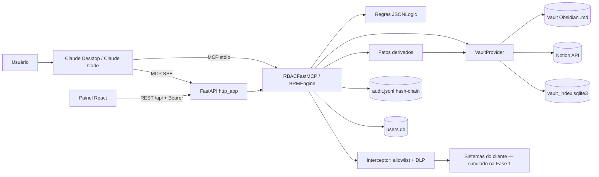

# Architecture

> **Fonte de verdade de "como o sistema funciona".** Muda por decisão explícita; toda decisão que afeta implementação entra em §9.
> Estado verificado em 2026-10-11 contra o código.

## 1. System Overview

O BRM Framework separa a volatilidade dos LLMs e dos sistemas do cliente da estabilidade das regras de negócio dele, usando MCP como ponte. São três camadas:

1. **Fonte oficial** — sistemas do cliente (ERP, prontuário, tribunais). O dado fica aqui.
2. **Vault** — conhecimento curado (modelos, protocolos, casos), atrás do contrato `VaultProvider`.
3. **Agente** — o Claude, orquestrando *tools* MCP. Ele interpreta linguagem natural; **não decide segurança**.

Entre o agente e as duas primeiras camadas fica o **motor** (`mcp_engine`): identidade → RBAC → regras → fatos derivados → interceptor (allowlist/DLP) → auditoria. Tudo que é segurança acontece no motor, de forma determinística.

## 2. Architecture Pattern

- **Pattern:** Monólito modular, **uma instância por cliente** (código compartilhado, configuração por cliente).
- **Reason:** Time de 2 pessoas e 1–3 clientes. Multi-tenant e Control Plane antecipariam a Fase 2 sem demanda comprovada. Isolamento por cliente é "qual diretório/arquivo", não "qual coluna". A complexidade futura fica atrás de `Protocol`s, de modo que trocar um adapter (YAML → API do Control Plane) não toca `rule_evaluator` nem `interceptor`.

## 3. Technology Stack

| Camada | Tecnologia |
|---|---|
| Linguagem | Python ≥ 3.11 (`.python-version` = 3.11), gerenciado com `uv` |
| Protocolo | MCP (`mcp>=0.8,<2`, `FastMCP`), transportes stdio e SSE |
| API/HTTP | FastAPI + uvicorn (SSE do MCP e REST `/api` do painel) |
| Validação | Pydantic v2 (`_StrictModel`: `extra="forbid"`, `frozen=True`) |
| Regras | JSONLogic sandboxado (`json-logic-qubit`) |
| Usuários/permissões | SQLite + SQLAlchemy 2 síncrono, um `users.db` por cliente |
| Auditoria | JSONL append-only com hash-chain, por cliente |
| Vault | Obsidian (`.md` + frontmatter + wikilinks, `python-frontmatter`, `watchdog`) ou Notion (REST via `httpx`) |
| Busca | SQLite FTS5 + `sqlite-vec` (`vec0`, 384 dims), fusão RRF; embeddings `sentence-transformers` locais (`paraphrase-multilingual-MiniLM-L12-v2`) |
| Agentes LLM | Agno 3.x (`output_schema` Pydantic); Anthropic direto ou OpenRouter, escolhido por variável de ambiente |
| Painel | React 19 + TypeScript + Vite 8 + Tailwind 4 + react-aria-components/shadcn |
| E-mail | Resend (`RESEND_BRM_API_KEY`) ou SMTP, só se configurado |
| Integração externa | API pública DataJud (CNJ) |
| Hosting | Local-first hoje. Deploy isolado por cliente (cloud BRM ou on-prem/Docker Compose) está **previsto, não versionado** |
| Qualidade | `ruff` (E, F, I; linha 100), `pytest`; painel com `oxlint` + `tsc` |

## 4. System Components

### Transportes (identidade)
- Resolvem **quem** chama e nada mais. `resolve_stdio_identity` (env `MCP_USER_EMAIL`/`MCP_API_TOKEN`, lida **uma vez**) e `resolve_http_identity` (header `Authorization: Bearer`, **por request**, via middleware). Ambos devolvem `UserProfile` e o publicam em um `ContextVar`.
- Nada fora dessas duas funções sabe que existe stdio ou HTTP.

### `mcp_engine/core/` — núcleo
- `mcp_server.py`: `BRMEngine` (orquestra tudo) e `build_server()` — **único ponto de registro de tools** para os dois transportes; gera uma tool tipada por skill.
- `rbac_server.py`: `RBACFastMCP` filtra `tools/list` e revalida `tools/call` (negativa vira evento `DENIED`).
- `auth.py`: `Role`, `UserProfile`, `ContextVar` de identidade, `is_tool_allowed`.
- `rule_evaluator.py`: avalia `rules.yaml` com JSONLogic; primeira regra que casa decide.
- `interceptor.py`: allowlist `fnmatch`, bloqueio de IP privado, DLP `mask`/`deny`, evento de auditoria; `check_vault_egress` (DLP estrito antes de enviar nota a um LLM); `redact_for_role`.
- `config_loader.py`: providers `FileSystem*` para `rules`, `skills`, `client_config`, `vault_access`, `demo_scenarios` (YAML, `schema_version: 1`).
- `user_store.py`: `SQLUserStore` (usuários, `tool_permissions`).
- `api_router.py` + `http_app.py`: REST do painel (`/api/*`, só `super_admin`) e app FastAPI que monta o SSE do MCP.
- `datajud.py`, `email_sender.py`: integrações reais.
- `contracts.py`, `models.py`: `Protocol`s (`RuleProvider`, `SkillProvider`, `ClientConfigProvider`, `AuditSink`) e modelos Pydantic.

### `mcp_engine/vault/` — conhecimento
- `provider.py` (contrato) · `obsidian_adapter.py`, `notion_adapter.py` (adapters) · `note_source.py` (`NoteSource`: de onde vêm as notas) · `index.py` (FTS5 + vec, RRF) · `embeddings.py` · `watcher.py` · `markdown.py`.
- `access.py`: políticas de leitura por nota (`vault_access.yaml`).
- `interpreter.py`, `document_generator.py`, `draft_store.py`, `_agent_common.py`: agentes que propõem rascunhos; **nunca** escrevem em produção.

### `audit/sink.py`
- `FileSystemAuditSink`: `<DATA_ROOT>/<cliente>/audit.jsonl`.

### `dashboard/`
- SPA React, só consome `/api/*` com token Bearer. Não acessa banco, arquivos nem MCP.

### `clients/<cliente>/`
- `config/` (versionado): `client_config.yaml`, `rules.yaml`, `skills.yaml`, `vault_access.yaml`, `demo_scenarios.yaml`, `*.draft.jsonl`; `users.db` (gerado, **não** versionado).
- `vault/`: convenção do vault Obsidian quando `vault_root` não é declarado.

## 5. Architecture Diagram



## 6. Data Flow — `call_skill` (a ação governada)

1. O usuário pede em linguagem natural; o Claude escolhe a tool da skill (ou `call_skill`).
2. **Transporte** já resolveu a identidade; **RBAC** (`RBACFastMCP.call_tool`) valida o perfil para essa tool. Negado → evento `DENIED`, retorno `{"allowed": false}`.
3. `BRMEngine.call_skill` localiza a skill (inexistente → negada e auditada).
4. **Fatos derivados** são calculados a partir do vault; qualquer argumento informado com o mesmo nome é descartado e a divergência é auditada (`<skill>:fato_divergente`).
5. Monta `facts` = `skill_name`, `actor`, `actor_role`, `origem_sistema`, argumentos, derivados. **Regras** avaliam:
   - `deny` → audita `DENIED`, devolve `reason` + `proximo_passo`.
   - `require_approval` → audita `PENDING_APPROVAL`, devolve "human approval required".
   - `allow` / sem regra → segue.
6. **Interceptor**: host fora da allowlist ou IP privado → bloqueia; DLP `deny` na resposta → bloqueia; sempre grava evento com `payload_digest`.
7. Execução: **resposta simulada** (Fase 1); `enviar_email` envia de verdade se configurado e não for simulação.
8. `mask` é redigido para perfis que não são `admin`/`super_admin`; se a skill declara `vault_read`, anexa trechos de notas dos tipos permitidos.
9. Resposta ao modelo: `{allowed, reason, result, payload_digest[, vault]}`.

**Fluxo do rascunho (regra/skill/documento):** nota → DLP de saída estrito → agente LLM (`output_schema` Pydantic) → validação JSONLogic → `*.draft.jsonl` (`pending`) → chamada separada e nomeada de promoção → escreve `rules.yaml`/`skills.yaml`/vault → evento de auditoria.

## 7. Project Structure

```text
brm-ai-framework/
├── AGENTS.md  CLAUDE.md            # instruções do agente (CLAUDE.md importa AGENTS.md)
├── docs/                           # este sistema de documentação
├── mcp_engine/
│   ├── core/                       # contratos, modelos, RBAC, regras, interceptor, servidor, API
│   ├── vault/                      # providers, índice, acesso por nota, agentes de rascunho
│   └── dynamic_skills/             # reservado (REST builder genérico — Fase 2)
├── audit/                          # FileSystemAuditSink
├── clients/<cliente>/{config,vault}
├── dashboard/                      # SPA React/Vite
├── scripts/                        # demos, pré-voo, preparação de perfis
├── tests/                          # pytest (um arquivo por módulo)
└── data/                           # DATA_ROOT: audit + índice (fora do git)
```

## 8. Dependency Rules

- `mcp_engine` **nunca fala com arquivo, banco ou API de vault diretamente**: fala com `Protocol`s (`RuleProvider`, `SkillProvider`, `AuditSink`, `VaultProvider`, `NoteSource`, `EmbeddingProvider`). Trocar implementação não pode exigir mudança no consumidor.
- Só `resolve_stdio_identity` e `resolve_http_identity` conhecem transporte. O resto lê `get_current_user()`.
- Registro de tools **somente** em `build_server()`. Nova tool = novo método no `BRMEngine` + registro lá + linha em [API.md](API.md).
- Regra e política são **dado** (JSONLogic). Proibido `eval`, `exec` ou condição em string livre.
- Fato de segurança **nunca** vem do modelo; entra por `derived_facts`.
- Saída de LLM **nunca** vai direto para produção: passa por `DraftStore` e promoção.
- Conteúdo de nota só sai da máquina rumo a um LLM depois de `check_vault_egress`.
- O painel só usa `/api/*`; a camada REST é fina e reutiliza `BRMEngine`, sem duplicar regra de negócio.
- Sem multi-tenant: nada de coluna `client_id` compartilhada nem acesso cross-client.

## 9. Key Technical Decisions

> A numeração preserva as antigas specs: **comentários no código que citam "spec NNN" apontam para `D-NNN` aqui.** O histórico completo está no git (último commit com as specs/changelogs: `f7cda5b`).

| ID | Decisão | Motivo / alternativa descartada |
|---|---|---|
| D-001 | Contratos como `Protocol` `@runtime_checkable`; modelos Pydantic `extra="forbid"`, `frozen` | Sem herança forçada; chave desconhecida no YAML falha na leitura; eventos/regras imutáveis |
| D-002 | JSONLogic sandboxado, `json-logic-qubit`; primeira regra que casa decide; **default `allow`** | `json-logic==0.6.3` não roda em Python 3 (`dict_keys[0]`). Default `allow` mantém o motor como *deny-list* — ver risco em [SECURITY.md](SECURITY.md) |
| D-003 | Interceptor: allowlist por `fnmatch`, `block_private_ip=True`, DLP `mask`/`deny`, digest SHA-256 do payload | Simples de configurar; NER (Presidio) fica para a Fase 2 |
| D-004 | Config em YAML por cliente, `schema_version: 1`, carregada na construção do engine (**mudou o YAML → reinicia o servidor**) | Evita migração dolorosa quando o Rule Builder existir |
| D-005 | Auditoria JSONL com hash-chain; **detecta, não previne** adulteração; leitura sem cache | Prova forense assimétrica/assinatura fica para a Fase 2 |
| D-006 | Entrypoint `BRMEngine` + `FastMCP`; execução HTTP **simulada** na Fase 1 | Execução real exige timeout/retry/TLS/segredos — passo próprio |
| D-007 | Plano de teste manual da Fase 1 | Absorvido por [TESTING.md](TESTING.md) |
| D-008 | Vault **Obsidian bidirecional** direto (pulou a Opção A "pgvector + espelho"); busca híbrida FTS5 + vetorial com RRF; reindex **antes** de cada `search`; conflito → cópia `<nota>.md-brm-conflict-<timestamp>` ao lado (cliente vence; sem extensão `.md`, não é indexada); `note_id` = caminho relativo; watcher em thread; índice em `DATA_ROOT`; embeddings locais | Valor comercial está no cliente editar o vault. Embedding em nuvem exigiria DLP no caminho |
| D-009 | Agente interpretador: nota → rascunho → promoção; saída só JSONLogic/Skill validado; DLP de saída estrito. Divergência: `requires_confirmation` do Agno **não** se aplica (promoção é tool MCP de nível superior), logo o gate humano é **procedural** | Nada de geração automática → produção |
| D-010 | RBAC dual-mode com `ContextVar`; identidade por request no HTTP, uma vez no stdio; sem credencial → `viewer` | Auth OAuth do SDK não se aplica a token de dicionário/DB |
| D-011 | Usuários em SQLite + SQLAlchemy 2 síncrono, **um DB por cliente**, sem Alembic; token em texto puro (dívida assumida); `seed_demo_users` explícito, nunca automático | Mesmo isolamento do resto do projeto; trocar a connection string migra para Postgres |
| D-012 | `super_admin` é perfil **por cliente** (não cross-client); `actor_role` entra nos fatos das regras; só `super_admin` atribui `super_admin` | Cross-client antecipa a Fase 2 sem demanda |
| D-013 | `tool_permissions` persistida e editável em runtime; REST `/api` só `super_admin`; `include_router` **antes** do `mount("/")`; CORS `*` | Sem permissão por tool em tabela o painel não teria o que editar. CORS `*` é aceitável só local-first |
| D-014/015 | Notion como espelho sobre o mesmo `VaultIndex` via `NoteSource`; token em `notion_token` ou `NOTION_TOKEN`; sem watcher; **sem rate limit** (~3 req/s) | Reaproveita busca híbrida; Notion não tem primitiva de watch |
| D-016 | Uma tool MCP por skill (tipada, com exemplos); `derived_facts`; `context` do cliente nas instruções do servidor; `next_step` nas regras | Cliente de chat lida bem com schema tipado |
| D-017 | `vault_access.yaml` (allow / metadata_only / deny, `default`, `write_roles`); `vault_read` mediado por skill; auditoria sem conteúdo | Leitura do vault vazava registro sem passar por regra |
| D-018 | Simulador e matriz (`simulacao=True`, `avaliar_skill`); identidade simulada via `ContextVar`; `simulador: false` desliga | Trocar de perfil ao vivo no Claude Desktop é frágil |
| D-019 | Documentação no formato "Vibe Coding Blueprint" (`PRD`, `DESIGN_SYSTEM`, `ARCHITECTURE`, `DATABASE`, `SECURITY`, `CODE_STYLE`, `TESTING`, `UX_FLOWS`, `API`, `AGENTS`), substituindo `spec.md`, `specs/`, `changelog/` | Contexto antes do código, fonte única, sem ritual de spec/changelog por passo |

## 10. Performance Considerations

- `reindex` roda antes de cada `search`: custa um `stat` por arquivo; só o que mudou é relido e reembedado.
- O modelo de embeddings carrega **lazy** na primeira chamada (vários segundos); `http_app` aquece o índice no *startup* e engole falha de aquecimento.
- `query_audit_log` relê o arquivo inteiro a cada chamada (O(n) e valida a cadeia). Aceitável hoje; reavaliar com volume real (paginação/rotação).
- SQLite síncrono é suficiente para um cliente; chamado dentro do middleware async sem I/O assíncrono.

## 11. Scalability Considerations

- Escala **horizontal por cliente** (mais instâncias), não vertical dentro de uma instância. Um cliente = um processo, um `users.db`, um índice, um `audit.jsonl`.
- Antes de passar de 1 escritor por arquivo (audit, drafts), definir estratégia de concorrência: hoje `record()` lê a última linha e anexa, sem trava entre processos.
- Vault muito grande pode exigir processo separado para o watcher e índice por lote — só se medido.
- Migração para Postgres/pgvector é troca de adapter (`VaultProvider`/connection string), não reescrita.

## 12. Failure Scenarios

| Cenário | Comportamento atual |
|---|---|
| `rules/skills/client_config` ausente ou inválido | `ConfigLoadError` na construção do engine (falha rápida) |
| Regra com condição malformada | `RuleEvaluationError(rule_id)`: a chamada falha, **não** vira `allow` |
| Política de `vault_access` que lança exceção | Tratada como "não casou" → cai no `default` |
| `vault_root` explícito inexistente | `VaultRootNotFoundError` (não cria o diretório) |
| Notion sem `notion_token`/`notion_root_page_id` | `NotionConfigError` na primeira chamada que precisa do índice |
| Notion fora do ar / rate limit | Erro HTTP propaga; **sem retry nem backoff** |
| Sem `ANTHROPIC_API_KEY`/`OPENROUTER_API_KEY` | `RuntimeError` só quando um agente é usado (construção lazy) |
| Nota com CPF/CID etc. rumo ao LLM | Bloqueada por `check_vault_egress`; evento `*_egress_check` |
| Watcher não inicia | Ignorado; o reindex antes de `search` mantém a correção |
| Cadeia de auditoria quebrada | `iter_events` levanta `AuditChainError` (consulta falha); escrita não revalida a cadeia |
| SMTP/Resend falha | `EmailSendError` → resposta negada e evento `DENIED` |
| DataJud falha | `DatajudError` → negada e auditada |
| `users.db` indisponível | Erro do SQLAlchemy propaga; **sem tratamento específico** (lacuna) |
| Token inválido/ausente | Perfil `anonymous` (`viewer`) — nunca `admin` |
| Download do modelo de embeddings sem rede | Falha na primeira indexação/busca; testes de embeddings falham offline |

## 13. Estado atual × planejado

| Tema | Hoje | Planejado |
|---|---|---|
| Execução das skills | Simulada (exceto e-mail) | HTTP real com timeout/retry/TLS e segredos por tenant |
| Regras/skills | YAML versionado + rascunhos | Control Plane com *staging → canary → produção* e rollback (Fase 2) |
| DLP | Regex (`mask`/`deny`) | NER (Presidio) |
| Auditoria | Hash-chain detecta adulteração | Assinatura criptográfica / export auditável |
| Deploy | Local | Docker Compose por cliente |
| Token | Texto puro em `users.db` | Hash + expiração |
